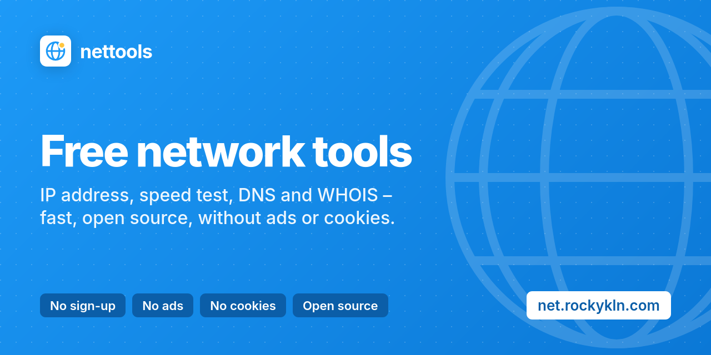

# nettools

[](https://github.com/Rockykln/nettools/actions/workflows/ci.yml)
[](LICENSE)

Ad-free network tools with a JSON API, running on Cloudflare Workers.

**Live:** https://net.rockykln.com · operated by [rockykln](https://github.com/Rockykln)



## Why another network toolbox?

Most lookup sites bury the answer under ads, cookie banners and upsells. nettools does one thing per page: you enter
a domain, IP or URL and get the result, rendered on the server, without JavaScript and without an account. Every
result has its own URL you can share, every lookup tool has a JSON endpoint you can script with curl, and the code is
here to read.

## Tools

| Tool | Path | What it does |
|---|---|---|
| What is my IP | `/what-is-my-ip` | Public IP, reverse DNS, ISP/ASN, approximate location, TLS and HTTP details (blurred until hovered) |
| IP lookup | `/ip-lookup` | Country, owner and abuse contact, announced prefix and origin AS, reverse DNS and blocklists for any IP |
| IPv6 test | `/ipv6-test` | Whether the connection works over IPv6, IPv4 or both (browser test against ipify) |
| What is my user agent | `/user-agent` | User agent string, parsed browser/OS/engine, client hints, screen and time zone; parses any UA |
| Port checker | `/port-checker` | Whether TCP ports on your IP or a server are open, closed or filtered |
| TCP ping | `/tcp-ping` | Connection latency, jitter and loss to any host and port |
| ASN & BGP lookup | `/asn-lookup` | AS holder, announced prefixes, upstreams and downstreams (RIPEstat) |
| MAC vendor lookup | `/mac-lookup` | Manufacturer from the IEEE registry, bulk input, randomized MAC detection |
| Range to CIDR | `/ip-range-to-cidr` | Convert address ranges to CIDR blocks and merge CIDR lists |
| Subnet calculator | `/subnet-calculator` | IPv4/IPv6 network, broadcast, host range, netmask; split into smaller subnets |
| Speed test | `/speed-test` | Download, upload, ping, jitter and data used, against the nearest Cloudflare data center |
| DNS lookup | `/dns-lookup` | All common record types via 11 public resolvers, or one record compared across 10 of them |
| Root DNS servers | `/root-dns-servers` | Live test and 24-hour history of all 13 root servers (cron every 30 minutes) |
| DNSSEC check | `/dnssec-check` | Chain of trust from the TLD to the domain: DS, keys, algorithms, bogus detection |
| WHOIS | `/whois` | Domains, IPs and AS numbers via RDAP, with WHOIS fallback for registries without RDAP |
| Domain availability | `/domain-availability` | Whether a name is free across 12 popular endings, straight from the registries |
| Subdomain finder | `/subdomain-finder` | Host names from Certificate Transparency logs (crt.sh) |
| Is it down? | `/is-it-down` | Whether a website is down for everyone, with status, timing, redirects and DNS |
| SSL certificate check | `/ssl-check` | Trusted handshake, HTTP→HTTPS redirect and current certificates from CT logs |
| Social preview checker | `/social-preview` | Open Graph/Twitter tags, image checks and preview cards (image proxied) |
| robots.txt checker | `/robots-txt` | Crawler rules per user agent (RFC 9309), path tester, sitemap check |
| HTTP headers | `/http-headers` | Redirect chain, response headers and a security header review |
| Email security | `/email-security` | SPF (with lookup count), DKIM, DMARC, MTA-STS, TLS-RPT and BIMI |
| Blacklist check | `/blacklist-check` | An IP or a domain's mail server on 12 DNS blocklists |
| Email header analyzer | `/email-headers` | Route, delays and SPF/DKIM/DMARC results of a message (runs in the browser) |
| Response time | `/response-time` | DNS, TCP, TLS, time to first byte and download, median of three connections |
| DNS speed benchmark | `/dns-benchmark` | Uncached and cached response times of 10 public resolvers |

- No cookies, no ads, no third-party scripts; page views are counted server-side in Analytics Engine
- Built-in observability: Workers Logs, traces and per-tool metrics in Analytics Engine ([docs/observability.md](docs/observability.md))
- Every lookup works without JavaScript; results are rendered on the server and have shareable URLs
- JSON API for every lookup tool, plain-text IP for the terminal

Focused pages for common checks, built on the tools above: [DNS propagation checker](https://net.rockykln.com/dns-propagation-checker),
[MX](https://net.rockykln.com/mx-lookup), [TXT](https://net.rockykln.com/txt-lookup), [NS](https://net.rockykln.com/ns-lookup),
[CNAME](https://net.rockykln.com/cname-lookup), [CAA](https://net.rockykln.com/caa-lookup) and
[reverse DNS](https://net.rockykln.com/reverse-dns-lookup) lookups, [online nslookup & dig](https://net.rockykln.com/nslookup-online),
[IP WHOIS](https://net.rockykln.com/ip-whois-lookup), and [SPF](https://net.rockykln.com/spf-checker),
[DKIM](https://net.rockykln.com/dkim-checker) and [DMARC](https://net.rockykln.com/dmarc-checker) checkers.

## API

```sh
curl net.rockykln.com          # just your IP (curl, wget, HTTPie and xh get plain text)
curl net.rockykln.com/ip
curl "net.rockykln.com/api/dns-lookup?name=example.com&type=MX"
curl "net.rockykln.com/api/whois?q=AS13335"
curl net.rockykln.com/api/root-dns-servers
curl net.rockykln.com/api/tools # all tools and landing pages with their API usage
```

Every lookup tool has a `GET /api/<slug>` endpoint; the parameters of each are listed on
[/api](https://net.rockykln.com/api). The speed test, IPv6 test and email header analyzer run in the browser and
have no public API. Responses are JSON, errors carry an `error` field. No key is needed;
requests are rate limited per IP address (per /64 for IPv6), and a limited request gets HTTP 429.
The header and email checks also serve grade badges at `/badge/<kind>/<domain>.svg`.

## How it works

Pages are rendered by a single Worker (`src/index.ts`) with no framework. Static files in `public/` are
served by Workers Static Assets.

- **DNS lookup** sends wire-format queries over DNS-over-HTTPS (DNS-over-TLS for Quad9) to the selected resolver.
- **Root DNS servers** opens TCP connections to port 53 of each root server with the
  [`connect()`](https://developers.cloudflare.com/workers/runtime-apis/tcp-sockets/) socket API and pipelines an
  `SOA .` and an `id.server CH TXT` query on each connection.
- **WHOIS** finds the responsible RDAP server through the IANA bootstrap files. For TLDs without RDAP it asks
  `whois.iana.org` for the WHOIS server and queries it on port 43.
- **IP lookup** finds the country in the DB-IP Lite database, stored by `npm run geo:update` as binary chunks in
  `public/data/geo/`; a lookup binary-searches a small index and one chunk of at most 4096 ranges.
- **Speed test** streams random data from and to the Worker; the measurement runs in the browser.

The DNS message encoder/decoder (`src/core/dns.ts`) is written from scratch and has no dependencies.

## Development

Requires Node.js 22 or newer.

```sh
npm install
npm run db:migrate:local   # create the local D1 tables
npm run dev                # http://localhost:8787
npm run check              # typecheck (runs `wrangler types` first) + unit tests
```

`npm run types` regenerates `worker-configuration.d.ts` after changes to `wrangler.jsonc`.

Some networks block DNS-over-HTTPS resolvers or intercept outbound DNS on port 53. If DNS lookups fail locally,
create `.dev.vars` with `DOH_BY_IP=1` to reach the resolvers by IP address. The root server test cannot work
around interception of port 53; it then shows your local resolver instead of the root servers.

`npm run brand` renders the social preview images in `public/og/` from `design/og.html` (needs Firefox, Python 3,
ImageMagick and a running `npm run dev`).

## Deploy

Production is deployed by Cloudflare Workers Builds from the `main` branch. One-time setup:

1. `npx wrangler login`, then `npx wrangler d1 create nettools --jurisdiction eu` and put the id into
   `wrangler.jsonc` (`d1_databases`).
2. Set the domain in `wrangler.jsonc` (`routes` and `vars.SITE_URL`). The zone must be on the same Cloudflare
   account.
3. Connect the repository under Workers → nettools → Settings → Builds, with the deploy command
   `npx wrangler d1 migrations apply nettools --remote && npx wrangler deploy`. Migrations in `migrations/` are
   applied before every deploy.
4. Nothing else: the IP country data (`public/data/geo/`) and the IEEE MAC vendor data (`public/data/mac/`) are
   static assets in the repository. The workflow `.github/workflows/update-data.yml` refreshes both on the 3rd of
   every month, runs the tests and pushes the result, which Workers Builds then deploys. `npm run data:update` does
   the same locally.

Without Workers Builds, the same works by hand: `npm run db:migrate && npm run deploy`.

The Workers Free plan is enough to start (100,000 requests per day). A speed test run uses about 60 requests.
Limits inside the Worker cannot protect that daily quota, because blocked requests are still counted. Add a
Cloudflare WAF rate-limiting rule in front of the Worker (the Free plan includes one), for example: path starts with
`/api/`, more than 100 requests per 10 seconds per IP, block for 10 seconds. For a public launch, Workers Paid
($5/month, 10 million requests) is the safer choice.

## Adding a tool

Each tool is one file in `src/tools/` that exports a `Tool` object (`src/core/tool.ts`). It defines the slug,
SEO metadata, the server-rendered UI, the explanatory article, FAQ and an optional JSON API. Register it in
`src/tools/registry.ts`; navigation, footer, sitemap, `/api/tools` and structured data pick it up automatically.
See [CONTRIBUTING.md](CONTRIBUTING.md).

## License

Code and logo: [MIT](LICENSE). MAC vendor data comes from the IEEE Registration Authority listings, used as
published. IP to country data: [IP Geolocation by DB-IP](https://db-ip.com), licensed under
[CC BY 4.0](https://creativecommons.org/licenses/by/4.0/). GitHub and the GitHub logo are trademarks of GitHub, Inc. Icons: [Phosphor Icons](https://phosphoricons.com), MIT ([public/assets/LICENSE-Phosphor.txt](public/assets/LICENSE-Phosphor.txt)).

The bundled font [Inter](https://rsms.me/inter/) is licensed under the SIL Open Font License 1.1
([public/assets/fonts/LICENSE-Inter.txt](public/assets/fonts/LICENSE-Inter.txt)).
